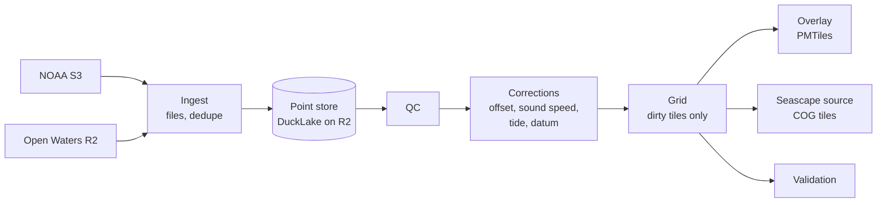

# Global depth grid

Crowd Depth collects soundings from boats and relays them to the IHO Data Centre for Digital Bathymetry (DCDB). This plan adds the other half: a pipeline that turns all crowdsourced soundings, from NOAA's public archive and from Open Waters' own submissions, into a global gridded depth product. It publishes a map overlay anyone can use online or download for offline use, and a source that [Seascape](https://github.com/openwatersio/seascape) merges into its bathymetry mosaic.

> [!WARNING]
> Crowdsourced soundings are not surveys. Everything this pipeline produces is **not for navigation**, and its design choices lean toward showing less rather than showing something that looks safer than it is.

Supporting notes:

- [The NOAA CSB archive](noaa-archive.md): how the archive is laid out and the data quirks the pipeline has to handle.
- [Standards](standards.md): what the IHO standards say about data quality, survey accuracy, and deriving depth areas, contours and soundings.
- [References](references.md): primary sources, research, and reusable code, with links.

## Goals

- One global grid, rebuilt incrementally as new soundings arrive, instead of per-region builds that re-read every file.
- A vector overlay with S-57 layer names (`SOUNDG`, `DEPARE`, `DEPCNT`) so chart plotters that style ENCs, such as Freeboard-SK, draw it without changes, plus a coverage layer that says how much each area can be trusted.
- A Seascape source, so crowd data fills in where only GEBCO exists today.
- Soundings corrected for vessel offsets, sound speed and tide, reduced to the same chart datum Seascape uses, with confidence recorded per cell.

## Principles

These follow from the standards and research in [standards.md](standards.md) and [references.md](references.md).

- **Never deeper than measured.** Every rounding, aggregation, rejection and generalization step errs shallow. This is the safety rule in IHO S-4 for charts, and Seascape applies it too. Corrections are the one stated exception: they aim at the true depth, so a correction can make a sounding deeper, but only when its parameters are known, never from an assumed value, and its uncertainty widens the sounding's.
- **Interpolate between tracks, never past them.** Depth areas and contours come from a surface interpolated between tracks within about 200 m, where there's a sounding on every side, and never deeper than an accepted sounding inside a pixel; past the ends of tracks the water is unsounded and has no surface. The surface records each pixel's distance to the nearest sounding, and soundings are always measured positions. The [depth surface](surface.md) plan has the details.
- **Crowd data is CATZOC D until shown otherwise.** This is the IHO Data Quality Working Group's recommendation for crowdsourced bathymetry. Upgrades need evidence: corrections applied, independent vessels agreeing, validation against surveys.
- **Metadata is a hint, not a fact.** A submission's depth reference, offsets and sensor positions are whatever the vessel's software and owner set, and they can be wrong without anything looking wrong. Every source is calibrated from its soundings, and reported metadata is at most a starting estimate.
- **Raw data is never overwritten.** Corrections, QC and calibration are derived tables that can be rebuilt as methods improve.
- **Every step has a fixed memory budget.** Work runs in units sized by a bound on points, not by area or vessel alone, and DuckDB spills to disk past its memory limit rather than growing, so a dense harbor or a ship's years of logs cost time, not memory. A cell's median, spread and 10th percentile are taken from a fixed sample of at most a million soundings, since those can't spill; a boat logging at its mooring fills one cell for as long as it logs. The point store, with the QC flags and cells built into it, has one writer. Rendering steps read it and run as independent units, so a build scales by running more of them at once, as Seascape's does.

## Inputs

| Source       | What                                                                                                                  | Size                                                                                              |
| ------------ | --------------------------------------------------------------------------------------------------------------------- | ------------------------------------------------------------------------------------------------- |
| `noaa`       | CSV point data in `s3://noaa-dcdb-bathymetry-pds/csb/csv/`, one file per submission, discovered by listing the bucket | About 784k files since 2017 and roughly 2 billion soundings, growing by about 750 MB of CSV a day |
| `openwaters` | GeoJSON submissions stored in R2 by the [API](../../../packages/api), with CSB 3.1 metadata                           | Smaller, but includes waters of non-IHO-member states, which NOAA does not publish                |

Plugin submissions reach NOAA too when they are in IHO member waters, so the two sources overlap. NOAA's copy is simplified, and its metadata is only available through a separate API, so the `openwaters` copy is the better one. Its metadata is still only a hint; see [Open Waters data](#open-waters-data). See [noaa-archive.md](noaa-archive.md) for both sources' layouts and quirks.

## Pipeline

### 1. Point store

The point store is [DuckLake](https://ducklake.select/) over Parquet on R2. DuckLake provides snapshots, deletes, compaction, and a query for what changed between snapshots, which drives incremental gridding. Its catalog is a single DuckDB or SQLite file owned by one scheduled writer. Each run takes a lock object on R2 with a conditional write and renews it while it works, so only a lock that has stopped being renewed is treated as stale. The current catalog is named by a pointer object. A run downloads the catalog the pointer names, uploads its result under a new versioned key, and moves the pointer with a conditional write against the version it started from, so a run that lost its lock can't overwrite a newer catalog, and a crashed run leaves the last good one in place.

The unit of storage, replacement and removal is the submitted **file**, not the point, because that is how sources change:

- NOAA replaces files in place when it reprocesses the archive and removes them when a country withdraws its data.
- Providers resubmit identical files under a new id.
- Vessels resubmit corrected data.

Tables:

| Table             | Holds                                                                                                                                                                                                                                                                                                        |
| ----------------- | ------------------------------------------------------------------------------------------------------------------------------------------------------------------------------------------------------------------------------------------------------------------------------------------------------------ |
| `files`           | One row per version of a source file: `source`, object key, `version`, `file_uuid`, `vessel`, ETag, content hash, arrival time, time range, `status` (active, superseded, withdrawn, invalid), the `reason` for it, what superseded it, and whether it holds its content's points                            |
| `points`          | Raw soundings exactly as received. `point_id` (a hash of the file version's content hash and row number), `file_id`, `row`, `unique_id`, `platform`, `provider`, `time` (UTC, microseconds), `time_raw`, `lon` and `lat` (double), `depth_raw` (float), `tile_id`, `cell_id` (the 10° partition), `batch_id` |
| `submission_meta` | Per-file metadata: depth reference, sensor and GNSS offsets, sounder, logger version, NOAA's response, and the original CSB 3.1 JSON                                                                                                                                                                         |
| `qc_flags`        | `point_id`, flag, reason, QC version, `cell_id` (the partition). `qc_batches` records which ingest batches (one per flush, `batch_id` on `points`) have been QC'd at which version                                                                                                                           |
| `vessel_offsets`  | Vessel, time range, vertical and horizontal offsets, their precision, method and reputation                                                                                                                                                                                                                  |
| `corrections`     | `point_id`, corrected depth, each correction applied with its method and uncertainty, corrections version                                                                                                                                                                                                    |
| `cells`           | Grid cells: tile, level (1, 3 or 9 base cells across), row and column, bounds, the [cell statistics](#cell-statistics), and the position of the sounding that sets the depth                                                                                                                                 |

`points` is partitioned coarsely (10° cells). Ingest writes points in the order files arrive, one track after another, so row groups stay spatially compact and their statistics prune reads to a few tiles; sorting a whole batch by tile would hold it in memory, so compaction sorts instead. Compaction runs weekly. Finer directory partitions would produce hundreds of thousands of tiny files, and NOAA's folders are dated by processing, not observation, so partitioning by year would not bound a rebuild.

#### Ingest

Each run lists the whole NOAA bucket and the whole R2 submissions bucket and compares ETags with `files`, which catches replaced and removed files as well as new ones. Listing costs about one request per thousand objects. A file whose ETag changed but whose content hash didn't keeps its row, with the new ETag recorded.

The R2 bucket's layouts are inventoried in [noaa-archive.md](noaa-archive.md#open-waters-submissions). Only `.geojson` files are submissions; sidecars hold NOAA's response, which ingest records.

Ingest validates every file itself and marks a file it can't parse or whose values are impossible as `invalid`. NOAA's response to a submission is recorded but doesn't decide whether it is used: the API records any 4xx as final, including an expired NOAA token or throttling, so a rejection says little about the data.

Withdrawals are guarded per source. Only a listing that completed every page can withdraw anything. A listing that returns no objects, or that would withdraw more than a small share of a source's active files (1% to start), holds its withdrawals and raises an alert, while new files are still ingested. Held withdrawals, kept in a `withdrawal_holds` table, apply when two consecutive listings agree and an operator confirms them. `files` is keyed by source and object key, so a file that disappears and comes back with the same content reactivates its row and keeps its point ids.

Dedupe works on files:

1. A file whose content matches an active file is a copy and is skipped. The content hash covers the source and the soundings (vessel, time, position and depth) whatever their order, and leaves out `FILE_UUID`, which differs between identical resubmissions. Each sounding is hashed and the hashes summed, so hashing a file takes fixed memory however large it is.
2. A file replaced in place supersedes its old version entirely, so points dropped by reprocessing disappear with it.
3. A file removed from its source is marked withdrawn, and its points leave every product on the next build.
4. Within a source, a newer file from the same vessel supersedes an older one only when it holds every sounding of the older file, matched by time and position. A retry or a corrected resubmission covering the same soundings wins. Otherwise both stay, and soundings identical in time, position and depth are counted once. A wider time range alone never supersedes, because a newer file can have gaps or coarser thinning.
5. Across sources, precedence applies per sounding, not per file. A `noaa` sounding from the same vessel that falls inside the time span of an active `openwaters` file is dropped as a duplicate, since NOAA's copy is a simplified version of the same upload. `noaa` soundings outside that span are kept, even when they come from a file that partly overlaps.

A plugin vessel's identity comes from the R2 key, which the API builds from the vessel's authenticated token. The ids inside the GeoJSON body are not checked by the API, so they are never trusted for identity, and a file whose body id disagrees with its key is marked `invalid`.

Vessel matching across sources is required, not optional, because `vessels` counts independent vessels and a boat counted twice would make its own track look corroborated. Plugin vessels are `SIGNALK-<uuid>`, and NOAA keeps that id as `UNIQUE_ID` ([checked](noaa-archive.md#open-waters-submissions)). Where NOAA's `UNIQUE_ID` for the same boat differs, or a boat appears under two ids (a reinstalled plugin, a second logger), vessels are matched by sounding at the same time and position.

Points are never deduplicated by `(unique_id, time)` alone. Time is recorded to the second, and loggers faster than 1 Hz produce different soundings with the same timestamp.

A coastal state's withdrawal from NOAA removes the `noaa` copy but not the plugin's own copy in R2. Whether Open Waters publishes that copy is decided in the consent phase.

### 2. Quality control

QC runs on each ingest batch as it lands, with its windows along each file: a submission is a contiguous piece of one vessel's track, so the work follows the file. A transit ends at a gap of more than 4 hours and every 7 days. A transit's first and last soundings aren't checked for position jumps, its first and last few are judged for spikes against one side only, and a transit of fewer than three soundings isn't checked for spikes. Most of the QC follows NOAA Office of Coast Survey's [CSB processing tool](https://github.com/anthonyklemm/Crowdsourced_Bathy_Processing), with its thresholds as starting values.

- Drop sentinels and impossible values: depths of zero or less (PGS writes 0 for no depth), `-1e9` missing-depth markers, depths beyond 11,000 m, and implausible times. The NOAA tool also drops depths under 0.5 m, but those can be real shoals, so they are flagged for review instead.
- Split each vessel's soundings into transits, starting a new one after a gap of more than 4 hours or after 7 days.
- Per transit: compute speed and flag soundings above about 20 kn as position jumps. Flag depth spikes by their residual from a rolling median along track, with an absolute threshold. The NOAA tool flags a fixed top percentile instead, which rejects some soundings even on clean transits. Reject a depth held unchanged over a kilometre or more as a stuck sounder: one that loses bottom often repeats its last reading, and on the Lynn Canal sample such runs were a median 17% off the other vessels' depths, against 5% for shorter runs.
- Per cell: robust outlier detection (median absolute deviation) across all soundings and vessels.
- Where a reference survey exists, compare soundings with it using 3.5 times their vertical uncertainty as the limit.

Rejection is one-sided. An outlier deeper than its neighbors or the survey is rejected. An outlier shoaler than them is never silently dropped, because it may be a rock, a pinnacle or a new shoal, which is what crowd data is best at finding. It is marked `unconfirmed`: it stays out of depth areas and contours, but publishes as a sounding with a low-reliability flag. A shoal needs confirming only when it stands out from the rest of its cell, and only readings that also stand out can confirm it: a second vessel or transit sounding it within its uncertainty, or three such soundings agreeing, so a feature a single track crosses, such as a channel edge, isn't taken for noise.

A sounder that has lost bottom is wrong the whole way along its track, so QC along the track can't see it. Each sounding is also judged against the other vessels within about 270 m, each voting once with its median depth. A sounding far deeper than their consensus is rejected. One far shoaler is rejected when three or more of them agree with each other, unless another vessel read the same depth, within 2 m + 5%, in the same block of about 90 m; a shoal that isn't disproved goes on to the cell's shoal confirmation. Every sounder in deep water throws stray shallow echoes at all sorts of depths, so only a reading of the same depth counts, and a shoal two vessels each crossed once still stands. The tolerance is the larger of 2 m + 5% of the consensus and three times the spread of the votes, so it widens on slopes. Where fewer than two other vessels sounded, nothing is judged this way. On the Lynn Canal sample this rejected 6,079 soundings far deeper than the other ships' and disproved 16,907 shoal readings, and neighboring cells' 90th-percentile disagreement fell from 4.6 times to 9%.

QC writes flags to `qc_flags` and never deletes points. Unconfirmed shoals stay there, out of cell depths, until the overlay publishes them.

### 3. Corrections

#### Vessel calibration

A vessel's soundings differ from the truth by its transducer depth below the waterline, any offset its logger already applied, and the sound speed its sounder assumes. None of these can be taken from metadata: a submission's stated depth reference and offsets are only as good as the vessel's configuration, so they set a starting estimate and the fit against a reference decides. Calibration compares tide-corrected soundings with a trusted reference where both exist:

- References are surveyed sources only: BlueTopo and S-102 in US waters, and Seascape's surveyed sources (CUDEM, EMODnet, INFOMAR, and others) elsewhere. GEBCO is too coarse and is never a reference.
- Fit on flat, stable seabed, where a small position error doesn't change depth, using low reference uncertainty and shallow-to-moderate depths (the NOAA tool uses reference uncertainty under 3 to 4 m, reference depth under 20 m, and differences under 12 m).
- Fit a vertical offset plus a depth scale factor, which absorbs a wrong assumed sound speed. Fit the horizontal offset between GNSS antenna and transducer where the seabed has features to lock on to, as the Canadian Hydrographic Service does.
- Use robust statistics (median and MAD), require a minimum number of soundings across more than one transit, and reject offsets outside a plausible range.
- Treat calibration as a time series, not one value per vessel. Sounders are moved and replaced. Each vessel carries a reputation that rises with agreement and decays with time since its last comparison, following Calder's work on observer reputation. Reputation weights the vessel's soundings when cells are combined.

A vessel that never overlaps a reference is used with its reported metadata, marked uncalibrated and weighted low. A depth measured below the transducer or keel but treated as below the waterline reads shallower than the truth, which errs safe, but it skews agreement between vessels, which is why uncalibrated vessels count for little.

#### Sound speed

Recreational sounders assume a fixed sound speed, often 1,500 m/s. The real speed varies with temperature and salinity, and the error scales with depth: about 3% in cold water, more than the tide error in deep water. Where a vessel's scale factor can't be calibrated, the harmonic mean sound speed from the [World Ocean Atlas](https://www.ncei.noaa.gov/products/world-ocean-atlas) climatology for the place and month gives the expected error. The speed a sounder assumes isn't recorded, so this correction is only applied where it makes depths shoaler. Where it would make them deeper, it widens the uncertainty instead.

#### Tide

Reduce each sounding by the water level at its time and place.

- US waters: NOAA's discrete tide zones, which give each zone a control station, a time offset and a range ratio, so the correction is `depth − ratio × level(time − offset)`. Station levels come from CO-OPS, falling back from observed 6-minute data to 6-minute predictions to interpolated high and low predictions. Series are fetched once per station and day and cached, and each sounding is interpolated at its own time with a tolerance. TCARI, which interpolates constituents and residuals between gauges, is more accurate where gauges are dense and is a later improvement.
- Near other coasts: harmonic predictions from the [Slackwater station database](https://github.com/openwatersio/slackwater-database), about 8,300 stations from NOAA and TICON-4. Stations licensed for non-commercial use only (about 700) are filtered out by their `license.commercial_use` field when stations are loaded, so the published grid stays openly licensed. A prototype on [#127](https://github.com/openwatersio/crowd-depth/pull/127) (`feat-csb-tides` on Dirk Wahrheit's fork) reduced 57% of Fiji's soundings to LAT this way, from the nearest station within 50 km, with a median correction of 1.2 m (0.5 to 2.0). It used the Slackwater engine that the signalk-tides plugin runs, so a boat sees the same water level the tiles were reduced with. The pipeline keeps that consistency by calling the Slackwater engine for predictions, or by testing any Python implementation against it, rather than running a second predictor that can drift from it.
- Offshore: FES2022 through pyTMD or PyFES, once the AVISO license text is confirmed to allow publishing grids corrected with it. AVISO describes the heights as available for all uses after free registration. TPXO is left out because it is licensed for non-commercial use only.

Each tide correction carries an uncertainty that grows with distance from its station or with the model's known error, and feeds the sounding's vertical uncertainty.

#### Datum

Convert from the tide reference to the low-water chart datum Seascape uses. Slackwater stations carry their own datums (LAT and MLLW relative to MSL), which gives the separation along the coast, and Seascape's datum grids and NOAA's VDatum (through vyperdatum) cover areas with published surfaces. Offshore, a global model's MSL-to-LAT separation applies.

Every correction records its method, so a cell's confidence can say whether its depths were calibrated against a survey, tide-corrected from a nearby station, or left raw.

### 4. Grid

#### Resolution

Crowd positions are good to about 10 m, so cells much smaller than that claim more than the data holds. The grid is variable resolution, like CHRT: statistics are computed on a base grid of 1/3 arc-second of latitude (about 10 m), with the longitude step widened by latitude band so cells stay roughly square, and each area is published at the finest level its data supports. Where two or more vessels sounded a 1″ cell, its base cells publish on their own. A single track is aggregated to 1″ where another vessel sounded the surrounding 3″ cell, and to 3″ where none did, keeping the shoalest base cell. Tiles are 1° and line up with the store's `tile_id`.

In web map terms, 1/3″ is about zoom 13 and 1″ about zoom 11 to 12 (512-pixel tiles). Vector tiles are built to zoom 13 and overzoomed beyond.

A tile is rebuilt when anything its cells depend on changes:

- points added to it, or files covering it superseded, withdrawn or found invalid;
- QC flags, corrections or calibration for a vessel with soundings in it, including reputation;
- a neighboring tile, within the margin that hole filling and aggregation read across;
- the grid version.

Ingest and each derived step write the tiles they touch to a `tile_changes` table, and the grid records the last change it consumed. Snapshots are kept until the grid has consumed them, and a grid run that finds its last snapshot gone rebuilds everything.

#### Cell statistics

| Field              | Meaning                                                                                                                                                                                                                                                             |
| ------------------ | ------------------------------------------------------------------------------------------------------------------------------------------------------------------------------------------------------------------------------------------------------------------- |
| `depth`            | Published shoal-biased depth: the 10th percentile of a base cell's accepted soundings, taken as an actual sounding, and never deeper than a confirmed shoal; an aggregated cell takes its shoalest base cell. Weighting by vessel reputation comes with calibration |
| `median`, `mad`    | Robust center and spread                                                                                                                                                                                                                                            |
| `min`, `max`       | Range of accepted soundings                                                                                                                                                                                                                                         |
| `count`, `vessels` | Accepted soundings and independent vessels, by `unique_id`                                                                                                                                                                                                          |
| `first`, `last`    | Survey date range, by month, or by year for cells sounded by one vessel                                                                                                                                                                                             |
| `tvu`              | Vertical uncertainty at 95%: for now the larger of the CATZOC C tolerance (2 m + 5% of depth) and the cell's spread, until corrections propagate it                                                                                                                 |
| `kind`             | How the cell got its depth: measured by several vessels, measured by one vessel, or filled                                                                                                                                                                          |
| `zoc`              | CATZOC: 5 (D), the IHO recommendation for crowdsourced data, until validation supports more                                                                                                                                                                         |

A cell sounded by a single vessel is published but marked, because one vessel's systematic error can't be detected without another to compare it with. Its dates are coarsened to the year, so a chain of single-vessel cells doesn't publish a dated track of one boat, including in waters NOAA doesn't publish. Its sounding still sits at its measured position: vessels that share soundings have chosen to publish where they sounded, and most already broadcast their positions on AIS. Products never carry vessel ids or names.

#### Holes

An empty cell is filled only when sounded cells bracket it on opposite sides within one cell, along a row, column or diagonal. It takes the shoaler neighbor, never an interpolated value, and is marked `filled`. A cell holding an unconfirmed shoal is never filled, since that would show deeper water over a measured shoal. A filled cell has no soundings: it carries its depth, uncertainty and kind, a zero count, and no statistics or dates. Cells never grow outward from tracks; between tracks, depth areas come from the depth surface. The one-cell fringe along the edge of coverage, where lone soundings are least reliable, is a candidate for trimming, as NOAA's `Bathy_edge_erosion` does for surveys.

#### Depth areas and contours

Depth areas and contours come from the [depth surface](surface.md): a raster per 1° tile on the cells' latitude and longitude grid (rows of 2/3″), interpolated between tracks with `gdal_grid` and cut into bands on Seascape's isobath ladder with `gdal_contour`. The surface is blurred lightly, never toward deeper water, and no pixel is deeper than the shoalest accepted sounding in it or next to it, so a shoal QC accepted stays in the areas. Contours are the edges the bands share. Crowd soundings past 200 m are mostly sounders that have lost bottom, so areas and contours stop at 200 m and deeper water shows soundings only.

### 5. Publish

Outputs go to R2 and are served from `tiles.openwaters.io/crowd-depth/`. Like Seascape's tiles, they are licensed CC BY 4.0, and their TileJSON and file metadata carry the attribution their inputs require: the IHO DCDB and NOAA, TICON-4 and the Slackwater stations used, AVISO for FES2022, and each survey used as a calibration reference, such as EMODnet. MapLibre reads them by HTTP range request, which needs CORS headers that GitHub release downloads don't send, and a global archive exceeds the 2 GiB limit on release assets.

#### Overlay

One global PMTiles archive, built so a plotter that styles ENCs portrays it the way charts portray low-quality data:

- `SOUNDG`: one sounding per measured cell (filled cells have none), placed at the position of the sounding that sets the cell's depth rather than the cell center. It matches [Seascape](https://github.com/openwatersio/seascape)'s soundings, so Seascape's sounding style draws it unchanged: the same `depth_m`, `depth_ft` and `depth_fm` labels rounded toward shoal (S-4 B-412), and the same shoalest-wins pyramid, which keeps the shoalest sounding of each area at every zoom and thins depths past 200 m and 1,000 m. The least depth inside each closed isobath down to 200 m is `prime` and shows at every zoom from its isobath's. Unconfirmed shoals publish too, marked `unconfirmed`. Each sounding carries `VALSOU`, `TECSOU` and low-quality `QUASOU` and `QUAPOS` (reported, not surveyed; or not confirmed) so ENC styles can mark it.
- `DEPARE`: depth bands cut from the surface, down to 200 m, each with both `DRVAL1` and `DRVAL2`, since a depth area missing `DRVAL1` draws as intertidal. Water the surface doesn't reach has no depth area.
- `DEPCNT`: band edges at Seascape's isobaths, each the boundary the shoaler and deeper areas share, so the edge of coverage is never drawn as a contour. Flagged approximate (`QUAPOS` 4) so styles can dash them, and shown by zoom on Seascape's scale tiers.
- `M_QUAL`: coverage polygons that never overlap, one per 1° tile, the surface's footprint, with CATZOC 5 (D), survey date range, vertical uncertainty (`SOUACC`, the largest of the tile's cells) and horizontal (`POSACC`, 10 m), sounding count, technique, and a note that the data is crowdsourced and unverified.

The archive is the contract with chart plotters and chart providers:

- One global archive at a URL that doesn't change between builds, with its TileJSON beside it.
- Metadata with `type=S-57`, which Freeboard needs before it applies S-52 styling to a vector chart, and a build version and date, so a client can tell when an extract is out of date.
- Each build replaces the archive at the same URL. Clients reading by range send the ETag they started with, as the PMTiles libraries do, so a build that lands mid-read is detected and the read restarts instead of mixing tiles from two builds.

Offline regions are cut from the global archive by range requests, with `pmtiles extract` or a chart provider doing the same.

#### Seascape source

4326 Cloud Optimized GeoTIFFs on chart datum with depth, uncertainty and cell-kind bands, following BlueTopo's depth, uncertainty and contributor layout, plus a footprint for Seascape's coverage layer. Seascape merges crowd cells over its base by remove-restore, as GEBCO and EMODnet merge sparse sources: the difference from the base is applied only where crowd data covers, the depth surface and the cells, and is never interpolated beyond it. It ranks above GEBCO and below every surveyed source.

### 6. Validation

Hold out surveyed areas (BlueTopo and S-102 multibeam) from calibration and compare the grid with them:

- The S-44 vertical uncertainty test, by depth band and region.
- The shoal detection rate: of the shoals in the survey, how many the grid shows at or shoaler than their true depth. RMSE alone says nothing about missed shoals.
- Error by cell kind, vessel count and CATZOC, to check that the confidence labels mean something.

Validation runs on every grid version, and its results decide whether a correction method or threshold change ships.

## Open Waters data

The plugin's submissions carry richer metadata than NOAA's files, but how much of it can be trusted depends on when it was sent. These are preconditions for using it, and follow-ups outside this pipeline.

- **The plugin's own metadata shows why metadata can't be trusted.** Released versions up to 1.2.6, which the API still accepts, label every submission `Waterline`. They prefer depth below the surface when the boat provides it, so many of those labels are right, but a vessel logging `belowKeel` or `belowTransducer` through a history provider is labeled `Waterline` with no offset added, and its sensor positions are the raw settings rather than offsets from the transducer. Later versions report the reference more carefully (07d227f), but still only from the owner's settings. Files stored before 2026-01-14 have no CSB metadata at all. Ingest stores the metadata and the `providerLoggerVersion` that produced it, and calibration treats both as a starting estimate, the same as for any other source.
- **The API should check the vessel id in the body.** It verifies the id in the form metadata against the vessel's token, but stores and forwards the GeoJSON body unchecked. Ingest takes identity from the R2 key, but a body naming another vessel still reaches NOAA's archive and comes back as a `noaa` file under that vessel's id. The API should reject a body whose ids disagree with the authenticated vessel, before storing or forwarding it.
- **Removing a vessel means suppressing both sources.** Deleting a vessel's R2 files would end rule 5's suppression of the matching NOAA soundings, which would then be published. A request to remove a contributor's data is handled by vessel id across both sources, built when the first request arrives.

## Removing data

Files removed from NOAA or deleted from R2 leave every product through `files`, with the caveat above for a vessel's own data. Nothing else is built for removal until someone asks for data to be withdrawn. If that happens, removal is by polygon, applied when gridding, without rewriting the point store.

## Plugin as a consumer

Offline charts belong to chart providers, not the crowd-depth plugin. [signalk-charts-provider-simple](https://github.com/dirkwa/signalk-charts-provider-simple) is adding PMTiles support, so it can serve the overlay directly and cut an extract for a box the user draws, the way it handles NOAA ENCs, and use the build version to tell the user when the extract is out of date.

The crowd-depth plugin's part is feedback to the contributor:

- The vessel's own fitted offsets and reputation, shown in the plugin's status, which tells a contributor whether their setup reads true and gives them a reason to keep sharing.

## Package

The pipeline lives in this repository as `packages/grid`, a Python project managed with uv, the way aiscast keeps its Go server next to its plugin. The root `package.json` makes every `packages/*` directory with a `package.json` a workspace, so `packages/grid` never has one, and it gets added to `.prettierignore`, the oxlint ignores, and the exclusions in `vitest.config.ts`, whose `projects: ["packages/*"]` would otherwise run any test file in it, including ones inside its virtualenv. `packages/grid/.venv` goes in `.gitignore`. It uses DuckDB and DuckLake for the point store, GDAL for rasters and polygons, tippecanoe for tiles, rasterio and numpy for corrections, and pyTMD for tide models.

CI gets a separate job for it, filtered to changes under `packages/grid`, so plugin changes never install GDAL. Builds run on a schedule on a machine with enough memory and disk for a full rebuild.

## Phases

- [ ] Consent: update the plugin's consent text to say Open Waters publishes products derived from the data, and decide how data collected under the earlier text is used. Nothing is published, including previews, until this is done.
- [ ] Point store: `files` and `points` tables, ingest with ETag tracking, file-level dedupe and supersession, for both sources.
- [ ] Raw grid: QC, variable-resolution grid with shoal-biased statistics, depth areas and contours, `M_QUAL` coverage, and PMTiles, as an unlisted preview only. Without tide and datum corrections its depths aren't on chart datum, and a plotter would draw them next to ENC depths as if they were. Unconfirmed shoals stay in `qc_flags` and out of cell depths, so a cell can be deeper than a shoal measured inside it. No preview ships, even unlisted, until the overlay publishes those shoals as low-reliability soundings. Until vessels are matched by sounding, `vessels` counts by `unique_id`, which is the same for a plugin vessel in both sources but counts a boat under two ids twice.
- [ ] Validation: held-out survey comparisons, the S-44 test and shoal detection rate, reported per grid version.
- [ ] Corrections: vessel calibration with reputation, sound speed, tide, chart datum, and confidence upgrades backed by validation.
- [ ] Public overlay: published and listed once tide and datum corrections and validation are in place.
- [ ] Seascape source: COG output and remove-restore merging in Seascape.
- [ ] Plugin: calibration feedback.

## Open questions

- The sound speed each provider's loggers assume, if any provider documents it.
- Whether the AVISO license asks anything of grids derived from FES2022 predictions, such as attribution.
- What evidence moves a cell from CATZOC D to C, following the IHO Data Quality Working Group's proposal.
- Where the scheduled build runs: Seascape's build machine, a dedicated box, or large GitHub Actions runners.
