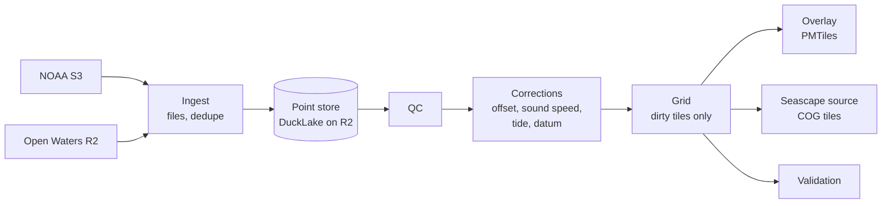

# Global depth grid

Crowd Depth collects soundings from boats and relays them to the IHO Data Centre for Digital Bathymetry (DCDB). This plan adds the other half: a pipeline that turns all crowdsourced soundings, from NOAA's public archive and from Open Waters' own submissions, into a global gridded depth product. It publishes a map overlay anyone can use online or download for offline use, and a source that [Seascape](https://github.com/openwatersio/seascape) merges into its bathymetry mosaic.

> [!WARNING]
> Crowdsourced soundings are not surveys. Everything this pipeline produces is **not for navigation**, and its design choices lean toward showing less rather than showing something that looks safer than it is.

Supporting notes:

- [The NOAA CSB archive](noaa-archive.md): how the archive is laid out and the data quirks the pipeline has to handle.
- [Standards](standards.md): what the IHO standards say about data quality, survey accuracy, and deriving depth areas, contours and soundings.
- [References](references.md): primary sources, research, and reusable code, with links.
- [Backlog](backlog.md): the prioritized work, from what the spikes below found.
- [Planet size](planet-size.md): how many 1° tiles the archive covers, how skewed they are, and how a day's arrivals spread.
- [Rebuild cost](rebuild-cost.md): what a daily planet rebuild costs, and what brings it within a day on cheap hardware.
- [Point store layout](store-layout.md), [Track QC as pure functions](qc-functions.md) and [Per-tile pipeline](per-tile-pipeline.md): spikes on the Chesapeake set.
- [Live layer](live-layer.md): the plugin's own-boat layer, drawn on top of the overlay with the same QC, corrections and portrayal.
- [Vessel calibration](vessel-calibration.md): per-vessel offsets against BlueTopo and from crossings, on the Chesapeake set.
- [Surface statistic](surface-statistic.md) and [Speckle in busy channels](channel-speckle.md): the grid against NOAA BlueTopo in Thimble Shoal Channel, Tangier Sound and Pocomoke Sound.

## Goals

- One global grid, rebuilt incrementally as new soundings arrive, instead of per-region builds that re-read every file.
- A vector overlay with S-57 layer names (`SOUNDG`, `DEPARE`, `DEPCNT`) so chart plotters that style ENCs, such as Freeboard-SK, draw it without changes, plus a coverage layer that says how much each area can be trusted.
- A Seascape source, so crowd data fills in where only GEBCO exists today.
- Soundings corrected for vessel offsets, sound speed and tide, reduced to the same chart datum Seascape uses, with confidence recorded per cell.

## Principles

These follow from the standards and research in [standards.md](standards.md) and [references.md](references.md).

- **Shoal-biased by a stated margin.** A cell's depth is a robust estimate minus a multiple of its uncertainty, so the margin toward shoal is explicit and published rather than hidden in a percentile. Published soundings are never deeper than measured, rounding and rejection err shallow as IHO S-4 requires, and hazards are carried by confirmed shoals, which generalization never removes. Corrections aim at the true depth, so a correction can make a sounding deeper, but only when its parameters are known, never from an assumed value, and its uncertainty widens the sounding's.
- **Legible over pixel-perfect.** The depth surface is smoothed so busy and quiet water both read clearly, accepting that smoothing can draw a pixel somewhat deeper than a sounding in it. Hazards don't depend on the surface: confirmed shoals publish as soundings and cap it, and unconfirmed shoals QC judged improbable don't affect it but publish as low-reliability soundings, which are the chart's warning there. Each change to the surface reports how often it is drawn more than 1 m deeper than a survey, and that share is kept as low as legibility allows.
- **Bounded, marked interpolation.** Water between tracks is unsurveyed, as S-4 treats passage soundings, but a chart of bare tracks isn't useful. Depth areas and contours come from a surface interpolated between tracks within 200 m, only where there's a sounding on every side; past the ends of tracks and beyond that distance the water stays empty. The surface records each pixel's distance to the nearest sounding and its σ, interpolated pixels are marked, and their σ widens with that distance. Soundings are always measured positions. Validation measures missed shoals in interpolated cells, since published comparisons of interpolation methods measure only overall error. The [depth surface](surface.md) plan has the details.
- **Crowd data is CATZOC D until shown otherwise.** This is the IHO Data Quality Working Group's recommendation for crowdsourced bathymetry. Upgrades need evidence: corrections applied, independent vessels agreeing, validation against surveys.
- **Metadata is a hint, not a fact.** A submission's depth reference, offsets and sensor positions are whatever the vessel's software and owner set, and they can be wrong without anything looking wrong. Every source is calibrated from its soundings, and reported metadata is at most a starting estimate.
- **Raw data is never overwritten.** Corrections, QC and calibration are derived tables that can be rebuilt as methods improve.
- **Every step has a fixed memory budget.** Work runs in units sized by a bound on points, not by area or vessel alone, and DuckDB spills to disk past its memory limit rather than growing, so a dense harbor or a ship's years of logs cost time, not memory. A cell's median, spread and vessels' medians are taken from a fixed sample of about a million soundings, since those can't spill; a boat logging at its mooring fills one cell for as long as it logs. Track QC is the exception: its windows run along a whole file, so it holds a batch's soundings (500k plus the last file's) and one file's working arrays in memory, about 200 bytes a sounding. The point store, with the QC flags and cells built into it, has one writer. Rendering steps read it and run as independent units, so a build scales by running more of them at once, as Seascape's does.

## Inputs

| Source       | What                                                                                                                  | Size                                                                                              |
| ------------ | --------------------------------------------------------------------------------------------------------------------- | ------------------------------------------------------------------------------------------------- |
| `noaa`       | CSV point data in `s3://noaa-dcdb-bathymetry-pds/csb/csv/`, one file per submission, discovered by listing the bucket | About 784k files since 2017 and roughly 2 billion soundings, growing by about 750 MB of CSV a day |
| `openwaters` | GeoJSON submissions stored in R2 by the [API](../../../packages/api), with CSB 3.1 metadata                           | Smaller, but includes waters of non-IHO-member states, which NOAA does not publish                |

Plugin submissions reach NOAA too when they are in IHO member waters, so the two sources overlap. NOAA's copy is simplified, and its metadata is only available through a separate API, so the `openwaters` copy is the better one. Its metadata is still only a hint; see [Open Waters data](#open-waters-data). See [noaa-archive.md](noaa-archive.md) for both sources' layouts and quirks.

## Pipeline

### 1. Point store

The point store is [DuckLake](https://ducklake.select/) over Parquet on R2. DuckLake provides snapshots, deletes, compaction, and a query for what changed between snapshots, which drives incremental gridding. Its catalog is a single DuckDB or SQLite file owned by one scheduled writer. Each run takes a lock object on R2 with a conditional write and renews it while it works, so only a lock that has stopped being renewed is treated as stale. The current catalog is named by a pointer object. A run downloads the catalog the pointer names, uploads its result under a new versioned key, and moves the pointer with a conditional write against the version it last published or started from, so a run that lost its lock can't overwrite a newer catalog, and a crashed run leaves the last good one in place. A long ingest publishes this way every 15 minutes, with its files' coverage settled, so a failure hours in loses only the work since, and a rerun skips the files already published. QC and the cells build publish the same way, at the first batch or tile group past 15 minutes. Rerunning `grid cells` resumes from the last checkpoint: it QCs only batches not yet done at this version, and keeps tile groups a stopped build finished from the same inputs. `grid qc` reruns every batch. A build that stops partway has already published some tile groups and removed the marker that says the cells are current, so the overlay waits until a rerun finishes.

The unit of storage, replacement and removal is the submitted **file**, not the point, because that is how sources change:

- NOAA replaces files in place when it reprocesses the archive and removes them when a country withdraws its data.
- Providers resubmit identical files under a new id.
- Vessels resubmit corrected data.

Tables:

| Table                                                                                  | Holds                                                                                                                                                                                                                                                                                                        |
| -------------------------------------------------------------------------------------- | ------------------------------------------------------------------------------------------------------------------------------------------------------------------------------------------------------------------------------------------------------------------------------------------------------------ |
| `files`                                                                                | One row per version of a source file: `source`, object key, `version`, `file_uuid`, `vessel`, ETag, content hash, arrival time, time range, `status` (active, superseded, withdrawn, invalid), the `reason` for it, what superseded it, and whether it holds its content's points                            |
| `points`                                                                               | Raw soundings exactly as received. `point_id` (a hash of the file version's content hash and row number), `file_id`, `row`, `unique_id`, `platform`, `provider`, `time` (UTC, microseconds), `time_raw`, `lon` and `lat` (double), `depth_raw` (float), `tile_id`, `cell_id` (the 10° partition), `batch_id` |
| `submission_meta`                                                                      | Per-file metadata: depth reference, sensor and GNSS offsets, sounder, logger version, NOAA's response, and the original CSB 3.1 JSON                                                                                                                                                                         |
| `qc_flags`                                                                             | `point_id`, flag, reason, QC version, `cell_id` (the partition). `qc_batches` records which ingest batches (one per flush, `batch_id` on `points`) have been QC'd at which version                                                                                                                           |
| `calibration`                                                                          | Vertical offset and standard error per vessel step segment, its time range, status (anchored, crossover, uncalibrated or rejected), and the anchor pixels, anchor transits and crossing transits behind it                                                                                                   |
| `file_offsets`                                                                         | The offset each file of a calibrated segment takes, which the grid applies, and the files it leaves out: known to read deep, or a transit that lost the bottom                                                                                                                                               |
| `calibration_outliers`                                                                 | Transits that disagree with their segment by more than a step, left uncalibrated, with the seabed depth they were judged over                                                                                                                                                                                |
| `lost_runs`                                                                            | Runs of soundings whose sounder lost the bottom, and the files of vessel months set aside, by the file's content, tile (none for a month) and time range; they set no depths, and those under 30 m and from 0.5 m publish as unconfirmed shoals                                                              |
| `reference_pixels`                                                                     | A surveyed reference (S-102, BlueTopo) sampled at a calibration pixel: depth below chart datum, relief within about 20 m, uncertainty and source                                                                                                                                                             |
| `tide_stations`, `tide_cells`, `tide_levels`, `tide_residuals`, `tide_residual_months` | The Slackwater stations tide reduction uses, each with its nearest CO-OPS gauge; each 0.02° cell's station; each station's level above chart datum per half hour, with its slope, uncertainty and method; and each gauge's observed minus predicted level; and when each gauge month was fetched             |
| `tile_changes`                                                                         | Tiles a calibration or tide change made stale, until `grid cells --changed` rebuilds them                                                                                                                                                                                                                    |
| `cells`                                                                                | Grid cells: tile, level (1, 3 or 9 base cells across), row and column, bounds, the [cell statistics](#cell-statistics), and the position of the accepted sounding nearest the depth                                                                                                                          |
| `shoals`                                                                               | Active soundings that are still unconfirmed shoals once cells are built: tile, base row, position and depth, which SOUNDG publishes flagged                                                                                                                                                                  |

Corrections are never written over `points`. Cells and the surface read each sounding with its tide level, interpolated at its own time, and its file's offset joined on, from the tables above.

`points` is partitioned coarsely (10° cells). Ingest writes points in the order files arrive, one track after another, so row groups stay spatially compact and their statistics prune reads to a few tiles; sorting a whole batch by tile would hold it in memory, so compaction sorts instead. Compaction runs weekly. Finer directory partitions would produce hundreds of thousands of tiny files, and NOAA's folders are dated by processing, not observation, so partitioning by year would not bound a rebuild.

#### Ingest

Each run lists the whole NOAA bucket and the whole R2 submissions bucket and compares ETags with `files`, which catches replaced and removed files as well as new ones. Listing costs about one request per thousand objects. A file whose ETag changed but whose content hash didn't keeps its row, with the new ETag recorded.

The R2 bucket's layouts are inventoried in [noaa-archive.md](noaa-archive.md#open-waters-submissions). Only `.geojson` files are submissions; sidecars hold NOAA's response, which ingest records.

Ingest validates every file itself and marks a file it can't parse or whose values are impossible as `invalid`. NOAA's response to a submission is recorded but doesn't decide whether it is used: the API records any 4xx as final, including an expired NOAA token or throttling, so a rejection says little about the data.

Withdrawals are guarded per source. Only a listing that completed every page can withdraw anything. A listing that returns no objects, or that would withdraw more than a small share of a source's active files (1% to start), holds its withdrawals and raises an alert, while new files are still ingested. Held withdrawals, kept in a `withdrawal_holds` table, apply when two consecutive listings agree and an operator confirms them. `files` is keyed by source and object key, so a file that disappears and comes back with the same content reactivates its row and keeps its point ids.

Dedupe works on files:

1. A file whose content matches an active file is a copy and is skipped. The content hash covers the source and the soundings (vessel, time, position and depth) whatever their order, and leaves out `FILE_UUID`, which differs between identical resubmissions. Each sounding is hashed and the hashes summed, so hashing a file takes fixed memory however large it is.
2. A file replaced in place supersedes its old version entirely, so points dropped by reprocessing disappear with it.
3. A file removed from its source is marked withdrawn, and its points leave every product on the next build.
4. Within a source, a newer file from the same vessel supersedes an older one only when it holds every sounding of the older file, matched by time and position. A retry or a corrected resubmission covering the same soundings wins. Otherwise both stay, and soundings identical in time, position and depth are counted once. A wider time range alone never supersedes, because a newer file can have gaps or coarser thinning.
5. Across sources, precedence applies per sounding, not per file. A `noaa` sounding from the same vessel that falls inside the time span of an active `openwaters` file is dropped as a duplicate, since NOAA's copy is a simplified version of the same upload. `noaa` soundings outside that span are kept, even when they come from a file that partly overlaps.

A plugin vessel's identity comes from the R2 key, which the API builds from the vessel's authenticated token. The ids inside the GeoJSON body are not checked by the API, so they are never trusted for identity, and a file whose body id disagrees with its key is marked `invalid`.

Vessel matching across sources is required, not optional, because `vessels` counts independent vessels and a boat counted twice would make its own track look corroborated. Plugin vessels are `SIGNALK-<uuid>`, and NOAA keeps that id as `UNIQUE_ID` ([checked](noaa-archive.md#open-waters-submissions)). Where NOAA's `UNIQUE_ID` for the same boat differs, or a boat appears under two ids (a reinstalled plugin, a second logger), vessels are matched by sounding at the same time and position.

Points are never deduplicated by `(unique_id, time)` alone. Time is recorded to the second, and loggers faster than 1 Hz produce different soundings with the same timestamp.

A coastal state's withdrawal from NOAA removes the `noaa` copy but not the plugin's own copy in R2. Whether Open Waters publishes that copy is decided in the consent phase.

### 2. Quality control

QC runs on each ingest batch as it lands, with its windows along each file: a submission is a contiguous piece of one vessel's track, so the work follows the file. A transit ends at a gap of more than 4 hours and every 7 days. A transit's first and last soundings aren't checked for position jumps, its first and last few are judged for spikes against one side only, and a transit of fewer than three soundings isn't checked for spikes. Most of the QC follows NOAA Office of Coast Survey's [CSB processing tool](https://github.com/anthonyklemm/Crowdsourced_Bathy_Processing), with its thresholds as starting values.

- Drop sentinels and impossible values: depths of zero or less (PGS writes 0 for no depth), `-1e9` missing-depth markers, depths beyond 11,000 m, and implausible times. The NOAA tool also drops depths under 0.5 m, but those can be real shoals, so they are flagged for review instead.
- Split each vessel's soundings into transits, starting a new one after a gap of more than 4 hours or after 7 days.
- Per transit: compute speed and flag soundings above about 20 kn as position jumps. Flag depth spikes by their residual from a rolling median along track, with an absolute threshold. The NOAA tool flags a fixed top percentile instead, which rejects some soundings even on clean transits. Treat a depth held unchanged over a kilometre or more as a stuck sounder: one that loses bottom often repeats its last reading, and on the Lynn Canal sample such runs were a median 17% off the other vessels' depths, against 5% for shorter runs. A run 30 m or deeper is rejected. A shallower one counts only if it also spans 200 m: a boat at its mooring piles up a kilometre of GPS jitter in minutes while its depth honestly holds, and a sounder stuck on a boat that stays that close still holds a reading from within 200 m. Such a run may be a flat shoal read by a coarse sounder, so it is kept as `unconfirmed`, and as a stuck run it never sets a depth, even where nothing else was sounded.
- Per cell: robust outlier detection (median absolute deviation) across all soundings and vessels.
- Where a sounding carries position quality, flag one without a GNSS fix (dead reckoning, simulator or no fix) and reject or down-weight one whose dilution or accuracy is past a threshold. Its horizontal accuracy sets the sounding's horizontal uncertainty, which feeds `M_QUAL`, and weights its position where positions are combined, such as placing a cell's sounding. A sounding without position quality takes the default of about 10 m.
- Per transit, deep side: a sounding deeper than twice the depth before it plus 5 m, plus a quarter metre for every metre between them, came faster than any seabed falls, so it's rejected as `steep`. The depth before counts as at least 10 m, so a sounder reading junk near the surface can't make the real bottom after it look steep. It's judged against the last sounding before it that wasn't, so a sounder that loses bottom for a stretch is caught whole, and from both directions, so a real descent that stays deep is kept. A sudden shoal is left to the spike check.
- Per transit: where soundings zig-zag by more than 10% of the depth, a sounder hunting between echoes, the spike check would keep one side and reject the other. Their deep side is marked `noisy` instead: it votes in the consensus below, but doesn't set cell depths, vote in or cap the surface, corroborate a shoal or calibrate the vessel. Their shoal side stays unconfirmed shoals, since one may be a rock, but ones that neither confirm nor are confirmed, since a hunting sounder's shoal side agrees with itself.
- QC judges soundings only against the crowd's own soundings, never a reference surface. A deep reading is caught by its own track or by other vessels; what's left is a lone vessel's track that is smooth but wrong, deep all the way, where no other vessel sounded.

Rejection is one-sided. An outlier deeper than its neighbors is rejected. An outlier shoaler than them is never dropped in water where it could be a hazard, because it may be a rock, a pinnacle or a new shoal, which is what crowd data is best at finding; a shoal QC can't confirm is rejected only at 30 m or deeper, where it can't be one. It is marked `unconfirmed`: it stays out of depth areas and contours, but publishes as a sounding with a low-reliability flag. A shoal needs confirming only when it stands out from the rest of its cell, and only readings that also stand out can confirm it, never one under 0.5 m, which is mostly a sounder's junk and agrees with other junk as readily as a shoal does: a second vessel or transit sounding it within its uncertainty, or three such soundings agreeing, so a feature a single track crosses, such as a channel edge, isn't taken for noise.

A sounder that has lost bottom is wrong the whole way along its track, so QC along the track can't see it. Each sounding is also judged against the other vessels within about 270 m, each voting once with its median depth. A sounding far deeper than their consensus is rejected. One far shoaler is disproved when three or more of them agree with each other, unless another vessel read the same depth, within 2 m + 5%, in the same block of about 90 m. A disproved shoal is rejected when it reads 30 m or deeper, and otherwise kept as `unconfirmed`, since one boat may have crossed a rock the others passed beside; a shoal that isn't disproved goes on to the cell's shoal confirmation. Every sounder in deep water throws stray shallow echoes at all sorts of depths, so only a reading of the same depth counts, and a shoal two vessels each crossed once still stands. The tolerance is the larger of 2 m + 5% of the consensus and three times the spread of the votes, so it widens on slopes. Wherever any other vessel sounded, a sounding far deeper than all of them, more than twice the deepest of their votes plus 10 m, with each vote counted as at least 10 m, is rejected (`consensus_far_deep`); where only one other vessel sounded, that's all that's judged, and where none did, nothing is. On the Lynn Canal sample this rejected 6,079 soundings far deeper than the other ships' and disproved 16,907 shoal readings, and neighboring cells' 90th-percentile disagreement fell from 4.6 times to 9%.

QC writes flags to `qc_flags` and never deletes points. Unconfirmed shoals stay there, out of cell depths; the cells build copies the ones still unconfirmed to `shoals`, which the overlay publishes, along with the soundings read after a sounder lost the bottom that read shoaler than 30 m and at least 0.5 m.

### 3. Corrections

#### Vessel calibration

A vessel's soundings differ from the truth by its transducer depth below the waterline, any offset its logger already applied, and the sound speed its sounder assumes. None of these can be taken from metadata: a submission's stated depth reference and offsets are only as good as the vessel's configuration, so they set a starting estimate and the fit against a reference decides. Calibration compares tide-corrected soundings with a trusted reference where both exist:

- References are surveyed sources only: BlueTopo and S-102 in US waters, and Seascape's surveyed sources (CUDEM, EMODnet, INFOMAR, and others) elsewhere. GEBCO is too coarse and is never a reference.
- Fit on flat, stable seabed, where a small position error doesn't change depth, using low reference uncertainty and shallow-to-moderate depths (the NOAA tool uses reference uncertainty under 3 to 4 m, reference depth under 20 m, and differences under 12 m).
- Fit a vertical offset. A depth scale factor, which absorbs a wrong assumed sound speed, waits until deeper water is in the set: at 2–20 m it barely narrows the spread ([vessel-calibration.md](vessel-calibration.md)). Fit the horizontal offset between GNSS antenna and transducer where the seabed has features to lock on to, as the Canadian Hydrographic Service does.
- Use robust statistics (median and MAD), require a minimum number of soundings across more than one transit, and reject offsets outside a plausible range.
- Where a vessel never overlaps a reference, solve its offset relative to other vessels at track crossings by least squares, as GMT's x2sys does, anchored to vessels that have a calibration. Crossovers alone give only relative offsets.
- Treat calibration as a time series, not one value per vessel. Sounders are moved and replaced. Each vessel carries a reputation that rises with agreement and decays with time since its last comparison, following Calder's work on observer reputation. Reputation weights the vessel's soundings when cells are combined.

`grid calibrate` solves one offset per vessel step segment. Each vessel's tide-reduced median per transit and 2/3″ pixel is compared with S-102 and BlueTopo, taken to MLLW, on flat seabed. A segment with at least 50 such pixels across 2 transits is anchored, weighted by its standard error rather than fixed. Every segment is also solved where it shares pixels with others, by robust least squares with the pixel depths eliminated, one unknown per segment. Each tile adds its pixels' terms to one sparse system, and each transit weighs as one observation however many pixels it crosses. Steps come from binary segmentation of each vessel's per-transit offsets. A segment without an anchor counts as calibrated from 5 crossing transits, when its crossings link it to an anchored one. Only calibrated offsets are applied, and only between −10 and +3 m with a standard error under 0.5 m: a negative offset deepens every sounding it corrects, so one past that is kept as `rejected`. A transit that disagrees with its segment's offset by more than a step is a step with too few transits on one side to be found, so it takes no offset and reads as logged, uncalibrated: in the Chesapeake a tug-barge's two transits before its sounder moved would otherwise have been corrected 4.6 m too deep. A stray transit reading more than 2 m shallower than its segment, and under half of what its segment reads over the same seabed (the survey's, or other vessels' where it has none), has lost the bottom rather than moved its sounder: in the Chesapeake 145 strays did, most reading a near-constant 0.2 to 2.5 m in 8 to 20 m of water, one vessel's 0.5 m at the bay mouth among them, while the other 12 read as a moved sounder would. Its soundings set no depths, vote in no consensus and draw no surface; those shoaler than 30 m and reading at least 0.5 m that QC didn't reject publish as unconfirmed shoals. The seabed comes from calibration, so a store calibrated before this rule finds none until `grid calibrate` runs again. A sounder that has lost the bottom holds a narrow band of readings for minutes to hours: in the Chesapeake 0.3 to 0.6 m or 2.4 to 3.0 m, wandering a tenth or two, for up to 15 km over 7 to 25 m of water. A file whose median doesn't stray from its segment can still hold such a run, so calibration also judges each vessel's file-pixel medians against the same test, by calendar month. A month with a fifth or more of at least 100 judged pixels reading lost is set aside whole: in the Chesapeake 14 months of 7 vessels, a fifth of the stuck readings, at 61,000 good pixels. A vessel with any month at 5% or more is searched sounding by sounding. A window of 30 readings is stuck where 27 of them read lost and the middle 80% of them span no more than 0.4 m, so the band's edges and a reading near the line don't break it; the seabed is the survey's, or the median of at least three vessels' corrected depths, whichever is shallower, so where three or more vessels sounded, water that has shoaled since the survey isn't mistaken for a lost bottom. A run joins overlapping stuck windows, runs from its first lost reading to its last, and counts from 60 stuck windows across 200 m, so a boat at its mooring, reading a slip shallower than the survey's pixel around it, goes uncounted. Only vessels with an applied offset are judged, since only they say what a vessel should read; where both exist, judging by three or more vessels instead of the survey finds 96% of the same soundings at 98% precision. A run's or a set-aside month's soundings set no depths, vote in no consensus and draw no surface; those shoaler than 30 m and reading at least 0.5 m that QC didn't reject publish as unconfirmed shoals. Runs and months are recorded by the file's content, so they follow the soundings when a copy takes over a withdrawn file's points; a file that arrives, or replaces another, since calibration is searched at the next `grid calibrate`. They are recorded with the calibration they were found under: `grid cells` refuses runs found under another calibration, or another version of the rule, until `grid calibrate` runs again. Anything known to read deep that isn't corrected is left out of cells and the surface, since as logged it would publish too deep: a segment not applied whose offset is more than 0.5 m deep by two standard errors, and a stray transit measured deep. Calibration reads only tide-reduced soundings, or ones `grid tide` found no station for; the overlay refuses offsets solved against tide levels that have since changed, and a run that would drop most of a store's calibrated segments at once is refused. Every `grid cells` first gives files that arrived since calibration their segment's offset. A rerun keeps a segment's published offset unless it moved by more than its standard error, and marks the tiles of every file whose offset changed for `grid cells --changed`. Reputation and horizontal offsets come later.

Offsets are the largest error in the grid: in Thimble Shoal Channel vessels read 0.6 to 5.4 m shallower than BlueTopo, constant per vessel ([surface-statistic.md](surface-statistic.md)). A vessel with neither a reference nor a crossover to a calibrated vessel is used with its reported metadata, marked uncalibrated and weighted low. A depth measured below the transducer or keel but treated as below the waterline reads shallower than the truth, which errs safe, but it skews agreement between vessels, which is why uncalibrated vessels count for little.

#### Sound speed

Recreational sounders assume a fixed sound speed, often 1,500 m/s. The real speed varies with temperature and salinity, and the error scales with depth: about 3% in cold water, more than the tide error in deep water. Where a vessel's scale factor can't be calibrated, the harmonic mean sound speed from the [World Ocean Atlas](https://www.ncei.noaa.gov/products/world-ocean-atlas) climatology for the place and month gives the expected error. The speed a sounder assumes isn't recorded, so this correction is only applied where it makes depths shoaler. Where it would make them deeper, it widens the uncertainty instead.

#### Tide

Reduce each sounding by the water level at its time and place.

- Near every coast: harmonic predictions from the Slackwater engine that the signalk-tides plugin runs, so a boat sees the same water level the tiles were reduced with. `grid tide` calls the engine in Node rather than running a second predictor that can drift from it. Each 0.02° cell takes the nearest station within 50 km from the [Slackwater station database](https://github.com/openwatersio/slackwater-database), about 5,800 usable tide stations from NOAA, TICON-4 and Kartverket. Stations licensed for non-commercial use only are left out by their `license.commercial_use` field, so the published grid stays openly licensed, as are stations whose harmonics Slackwater doesn't accept and stations without a chart datum: levels about a station's own datum sit near mean sea level and would read depths deeper than chart datum. Lake gauges are left out too: a Great Lakes station's lowest low water comes from its level record, not the tide, so its levels aren't a reduction to the lakes' low water datum. The tiles credit Slackwater and every licensed station whose levels they use. NOAA's subordinate stations carry their control station's time and height corrections, which is what discrete tide zones would add, at a station's spacing rather than a zone's, and without the zone model's gaps. A prototype on [#127](https://github.com/openwatersio/crowd-depth/pull/127) (`feat-csb-tides` on Dirk Wahrheit's fork) reduced 57% of Fiji's soundings to LAT this way, with a median correction of 1.2 m (0.5 to 2.0).
- US waters: the weather's part of the water level, which predictions miss, is added from the nearest CO-OPS water level gauge within 100 km: its observed minus predicted 6-minute level at the same time. A gauge month is fetched again on each run until it is final, 45 days after it ends. TCARI, which interpolates constituents and residuals between gauges, is more accurate where gauges are dense and is a later improvement.
- Offshore: FES2022 through pyTMD or PyFES, once the AVISO license text is confirmed to allow publishing grids corrected with it. AVISO describes the heights as available for all uses after free registration. TPXO is left out because it is licensed for non-commercial use only.

Levels are kept per station and half hour, with the slope to the next, for the days soundings need, and a sounding's level is interpolated at its own time. Each carries an uncertainty that grows with distance from its station and its gauge, starting at 0.10 m with a gauge's residual and 0.25 m without, and it feeds the cell's vertical uncertainty. A sounding left without a tide level carries 0.5 m for it, and one left without a calibrated offset 1.0 m, so uncorrected water reads as less well known than corrected water wherever this exceeds the CATZOC C tolerance that sets a cell's least `tvu`. These are starting values, until held-out gauges measure them. Levels are relative to each station's chart datum: MLLW in US waters, LAT, LLWLT or a similar low-water datum in most others, and mean sea level where a station's chart datum is MSL, which in the station database today is the Baltic's alone. A gauge month is final 45 days after it ends, since gauge data arrives late and is verified later; until then each run fetches it again and redoes its stations' levels for that month. Each run also gives every cell its nearest station, so one that joins nearer takes cells over, and a new Slackwater engine or station database predicts every level again.

#### Datum

Near a station, tide reduction already lands on the station's chart datum (MLLW, LAT or a similar low-water datum, or MSL in the Baltic), and calibration anchors are taken to MLLW, so those depths are on chart datum without a separate step. Where no station reaches, soundings keep the water level they were logged at. Seascape's datum grids and NOAA's VDatum (through vyperdatum) cover areas with published surfaces, and offshore a global model's MSL-to-LAT separation applies, with FES2022 for the tide there.

Every correction records its method, so a cell's confidence can say whether its depths were calibrated against a survey, tide-corrected from a nearby station, or left raw.

### 4. Grid

#### Resolution

Crowd positions are good to about 10 m, so cells much smaller than that claim more than the data holds. The grid is variable resolution, like CHRT: statistics are computed on a base grid of 1/3 arc-second of latitude (about 10 m), with the longitude step widened by latitude band so cells stay roughly square, and each area is published at the finest level its data supports. Where two or more vessels sounded a 1″ cell, its base cells publish on their own. A single track is aggregated to 1″ where another vessel sounded the surrounding 3″ cell, and to 3″ where none did, keeping the shoalest base cell. Tiles are 1° and line up with the store's `tile_id`.

In web map terms, 1/3″ is about zoom 13 and 1″ about zoom 11 to 12 (512-pixel tiles). Vector tiles are built to zoom 13 and overzoomed beyond.

A tile is rebuilt when anything its cells depend on changes:

- points added to it, or files covering it superseded, withdrawn or found invalid;
- QC flags, corrections or calibration for a vessel with soundings in it, including reputation;
- a neighboring tile, within the margin the surface reads across;
- the grid version.

Calibration and tide write the tiles they make stale to a `tile_changes` table, and `grid cells --changed` rebuilds them; cells that were current before the change are current again once every marked tile is rebuilt. Ingest doesn't write them: new and withdrawn files make the cells' inputs differ, so `grid overlay` asks for a full `grid cells` until the per-tile pipeline rebuilds only the tiles files touch. Snapshots are kept for 7 days, so the incremental grid has to run at least weekly or retention has to wait for it; a grid run that finds its last snapshot gone rebuilds everything.

#### Cell statistics

| Field                 | Meaning                                                                                                                                        |
| --------------------- | ---------------------------------------------------------------------------------------------------------------------------------------------- |
| `depth`               | Published depth: the median of per-vessel medians, after calibration, minus k × `sigma`, or a confirmed shoal in the cell where that's shoaler |
| `median`, `mad`       | Robust center and spread                                                                                                                       |
| `min`, `max`          | Range of accepted soundings                                                                                                                    |
| `count`, `vessels`    | Accepted soundings and independent vessels, by `unique_id`                                                                                     |
| `first`, `last`       | Survey date range, by month, or by year for cells sounded by one vessel                                                                        |
| `sigma`               | Uncertainty of `depth`: the corrections' uncertainty combined with the vessels' spread around a local plane                                    |
| `tvu`                 | Vertical uncertainty at 95%: 1.96 × `sigma`, or CATZOC C's 2 m + 5% where that's larger                                                        |
| `kind`                | Measured by several vessels or by one                                                                                                          |
| `tided`, `calibrated` | Accepted soundings reduced for tide, and with a calibrated vessel offset                                                                       |
| `zoc`                 | CATZOC: 5 (D), the IHO recommendation for crowdsourced data, until validation supports more                                                    |

The statistic, from [surface-statistic.md](surface-statistic.md), is computed on the surface's 2/3″ pixels, the same way for cells and the surface ([statistic.py](../../../packages/grid/src/grid/statistic.py)). The surface's windows also read the neighboring tiles' soundings, and where a window is too thin for a plane, it takes the spread around the interpolated surface rather than the pixel's own median, so at tile edges and in sparse water a cell's σ and the surface's can differ:

- **Votes.** Each vessel votes once per pixel with its median corrected depth there, however fast it logs, smoothed along its own coverage: at each pixel anyone sounded, a vessel with a sounding within a pixel of it votes its median over that reach. Which vessels sound a pixel then changes gradually along a lane rather than pixel by pixel. With the surface's smoothing, that takes the roughness between neighbouring pixels down by about 40%, in busy and quiet water alike. A base cell takes its pixel's statistic, so a cell's sounding and the surface agree where they meet.
- **σ.** Within 2 pixels (about 40 m) each way, the corrections' σ is the median of the vessels' median `sigma` (tide and calibration combined). Their spread is 1.4826 × the median absolute deviation of the vessel medians around a least-squares plane fitted to them, so a slope isn't counted as disagreement. With 3 or 4 votes in the window, or votes at fewer than 3 pixels, the spread is taken around the pixel's depth instead; with fewer than 3, from the nearest pixel that has one. σ combines the two: √(spread² + corrections' σ²). A tile where no window has 3 votes has no spread, only the corrections'.
- **Depth.** The median of the votes less k × σ, with k = 1.75 in [definitions.json](../../../packages/grid/src/grid/definitions.json). k = 1.75 is the smallest that keeps Thimble Shoal Channel's channel under 0.5% of pixels more than 1 m too deep.
- **Drying.** The margin alone never makes wet water drying: a depth goes below 0 m only where the vessels' median, or a confirmed shoal, is below it. An uncalibrated vessel without tide has σ of at least 1.1 m, so without this every one of them in shallow water would draw a drying line.
- **Hazards.** A confirmed shoal sets its cell's depth when it's shoaler, however many deeper vessels surround it, and the cell's sounding then sits at it. It stays confirmed only within 2 m + 5% of the other vessels' median in its pixel, or its 3×3 where the pixel has fewer than 2 other vessels (`shoal_check_vessels`); farther shoal than that, the other vessels outvote it, each voting once, and it becomes an unconfirmed `consensus_shoal`, as a reading other vessels disproved, published as an unconfirmed sounding. Echoes off piers and moored hulls that many vessels read confirm each other, and this keeps them from capping the surface. Where fewer than 2 other vessels sounded, a confirmed shoal stands. A cell publishes one sounding, so of two confirmed shoals in one aggregated cell only the shoaler is a sounding; the surface still holds both. No cap on the shoalest sounding: in a busy channel it drew every disagreement as a shoal.

An aggregated cell keeps its shoalest base cell's depth and σ, so aggregation never hides a shoal. A cell's sounding sits at the accepted sounding nearest its depth.

A cell sounded by a single vessel is published but marked, because one vessel's systematic error can't be detected without another to compare it with. Its dates are coarsened to the year, so a chain of single-vessel cells doesn't publish a dated track of one boat, including in waters NOAA doesn't publish. Its sounding still sits at its measured position: vessels that share soundings have chosen to publish where they sounded, and most already broadcast their positions on AIS. Products never carry vessel ids or names.

#### Interpolation

The surface is where interpolation happens: a surface pixel within 200 m of accepted soundings, with a sounding on every side, takes an interpolated median, less the same k × σ margin. Its σ comes from the nearest sounded pixel and widens with its distance d from the nearest sounding, √(σ² + (r·d)²), with r = 0.005 (`sigma_per_m` in the definitions): about 1 m more σ at 200 m. Leaving each vessel out in Tangier Sound, the interpolation's error against that vessel's own soundings spreads 0.36 m beside a track, about 0.58 m at 60 to 100 m and 1 m at 150 m. Thimble Shoal Channel's tracks are too close together to show it. A pixel more than a pixel from any sounding is interpolated: the surface's soundings band reads 0 there, and the overlay's coverage marks it. The surface ignores soundings QC judged improbable against their context: a spike against its own track, a noisy track, a cell shoal below its cell's accepted median, a reading other vessels disproved, a stuck run, a reading after the sounder lost the bottom. Each publishes as an unconfirmed sounding, a lost-bottom reading only from 0.5 m, and the surface is drawn from the other votes as if it weren't there; a pixel that held only such soundings is interpolated from its neighbours where they reach, or stays empty like unsounded water. A cell shoal with no accepted soundings around it to judge it against is unjudged (`cell_unjudged`), not improbable: it votes like any accepted sounding, and still publishes as unconfirmed until something confirms it. Each sounding counts toward its own cell's median, so this happens only where the cell's fixed sample leaves out every accepted sounding. Leaving pixels empty over every unconfirmed shoal left 80% of Thimble's busiest pixels empty, since in busy water some vessel almost always logs a stray reading. Cells hold only water vessels sounded. Beyond 200 m the water stays empty; in the Seascape mosaic, crowd cells will later feather into the base there. The fringe along the edge of coverage, where lone soundings are least reliable, is a candidate for trimming, as NOAA's `Bathy_edge_erosion` does for surveys.

#### Depth areas and contours

Depth areas and contours come from the [depth surface](surface.md): a raster per 1° tile on the cells' latitude and longitude grid (rows of 2/3″), interpolated between tracks with `gdal_grid` and cut into bands on Seascape's isobath ladder with `gdal_contour`. `gdal_grid` adds 40 m of smoothing to every point's distance, so a sounded pixel takes its neighbours' depths too, and the surface is blurred over 2 pixels, never toward deeper water, before the k × σ margin is taken off, and no pixel is deeper than a confirmed shoal in it or next to it, so a confirmed shoal stays in the areas wherever the surface reaches; at a lone track or a track's end, where it doesn't, the shoal shows only as a sounding. Contours are the edges the bands share. Crowd soundings past 200 m are mostly sounders that have lost bottom, so areas and contours stop at 200 m and deeper water shows soundings only.

### 5. Publish

Outputs go to R2 and are served from `tiles.openwaters.io/crowd-depth/`. Like Seascape's tiles, they are licensed CC BY 4.0, and their TileJSON and file metadata carry the attribution their inputs require: the IHO DCDB and NOAA, TICON-4 and the Slackwater stations used, AVISO for FES2022, and each survey used as a calibration reference, such as EMODnet. MapLibre reads them by HTTP range request, which needs CORS headers that GitHub release downloads don't send, and a global archive exceeds the 2 GiB limit on release assets.

#### Overlay

One global PMTiles archive, built so a plotter that styles ENCs portrays it the way charts portray low-quality data:

- `SOUNDG`: one sounding per measured cell (interpolated water has none), placed at the accepted sounding nearest its depth, a confirmed shoal's own position when one set it, rather than the cell center. It matches [Seascape](https://github.com/openwatersio/seascape)'s soundings, so Seascape's sounding style draws it unchanged: the same `depth_m`, `depth_ft` and `depth_fm` labels rounded toward shoal (S-4 B-412), and the same shoalest-wins pyramid, which keeps the shoalest sounding of each area at every zoom and thins depths past 200 m and 1,000 m. The least published cell depth inside each closed isobath down to 200 m is `prime` and shows at every zoom from its isobath's. Unconfirmed shoals publish too, marked `unconfirmed`. Each sounding carries `VALSOU`, `TECSOU` and low-quality `QUASOU` and `QUAPOS` (reported, not surveyed; or not confirmed) so ENC styles can mark it.
- `DEPARE`: depth bands cut from the surface, down to 200 m, each with both `DRVAL1` and `DRVAL2`, since a depth area missing `DRVAL1` draws as intertidal. Tide-reduced depths can be negative, drying heights; the first band holds them, from −30 to 0 m, and 0 m is drawn as the drying line. Water the surface doesn't reach has no depth area.
- `DEPCNT`: band edges at Seascape's isobaths, each the boundary the shoaler and deeper areas share, so the edge of coverage is never drawn as a contour. Flagged approximate (`QUAPOS` 4) so styles can dash them, and shown by zoom on Seascape's scale tiers.
- `M_QUAL`: coverage polygons that never overlap, up to two per 1° tile covering the surface's footprint: `kind` `measured`, within a pixel of a sounding, and `interpolated`, between tracks, so styles can show interpolated water. Each has CATZOC 5 (D), survey date range, vertical uncertainty (`SOUACC`: the largest `tvu` of the tile's cells for measured coverage, and the largest of 1.96 σ or 2 m + 5% over its pixels for interpolated) and horizontal (`POSACC`, 10 m), sounding count, technique, and a note that the data is crowdsourced and unverified.

The archive is the contract with chart plotters and chart providers:

- One global archive at a URL that doesn't change between builds, with its TileJSON beside it.
- Metadata with `type=S-57`, which Freeboard needs before it applies S-52 styling to a vector chart, and a build version and date, so a client can tell when an extract is out of date.
- Each build replaces the archive at the same URL. Clients reading by range send the ETag they started with, as the PMTiles libraries do, so a build that lands mid-read is detected and the read restarts instead of mixing tiles from two builds.

Offline regions are cut from the global archive by range requests, with `pmtiles extract` or a chart provider doing the same.

#### Seascape source

4326 Cloud Optimized GeoTIFFs on chart datum with depth, uncertainty and cell-kind bands, following BlueTopo's depth, uncertainty and contributor layout, plus a footprint for Seascape's coverage layer. Seascape merges crowd cells over its base by remove-restore, as GEBCO and EMODnet merge sparse sources: the difference from the base is applied where crowd data covers, the depth surface and the cells, and feathered into the base at the edges of crowd coverage, a design still to be worked out. It ranks above GEBCO and below every surveyed source.

### 6. Validation

Hold out surveyed areas (BlueTopo and S-102 multibeam) from calibration and compare the grid with them:

- The S-44 vertical uncertainty test, by depth band and region.
- The shoal detection rate: of the shoals in the survey, how many the grid shows at or shoaler than their true depth. RMSE alone says nothing about missed shoals.
- Error by cell kind, vessel count and CATZOC, to check that the confidence labels mean something.

Validation runs on every grid version, and its results decide whether a correction method or threshold change ships.

#### Benchmark

`grid --store S benchmark --surface DIR --out DIR` scores a render's depth surface, and with `--cells` its cells, against the store's `lake.reference_pixels`. Truth at each 2/3″ pixel is the least uncertain reference there, at chart datum. Each COG is read on its own pixel grid, the grid the references were sampled on, so nothing is resampled. A COG on any other grid is refused, since even a fraction of a pixel's offset doubles the share that reads too deep. The command writes `benchmark.json`, which is comparable between runs, and `benchmark.md`, a table of the same numbers. `--bbox` or `--tiles` limits the tiles, `--source` the references, and `--qc-version` picks the QC flags that decide accepted soundings and confirmed shoals.

The metrics, overall and per class: bias (median of estimate − reference, positive reads deep), the share more than 1 m deeper than the reference's shoalest (depth − relief, which on a slope is shoaler than the surveyed minimum, so the share there errs high), the share of false shoals more than 2 m shoaler, the share under 1 m where the reference is 2 m or deeper, and roughness (median |difference| to the 4 neighbours). Shares are of the pixels the estimate covers (the under-1 m share of those with a reference of 2 m or more), and coverage is reported beside them. Where the COGs have a σ band, its median is reported too. The classes are reference depth (<2, 2–5, 5–12, ≥12 m, each from its lower bound up to but not including the next), slope (relief over 0.5 m) or flat, measured or interpolated pixels, vessels with an accepted sounding in the pixel (0, 1, 2–3, 4–9, 10+), within one pixel of a confirmed shoal (flagged `confirmed` for `cell_shoal`) or not, calibration anchor or held out, and reference source.

Calibration anchors vessel offsets on these same references, so the benchmark flatters any pixel calibration could anchor on. The `anchor` class marks pixels where any source's sample is within calibration's anchor limits (2–20 m, uncertainty under 2 m, relief under 0.5 m), whether or not a vessel anchored there, and `held out` is the fairer number. Held-out pixels are mostly the water calibration won't anchor on, though, so the comparison is not like for like. A true holdout means calibrating without an area's references and benchmarking that area. The surface is what the render wrote, but vessels, shoals and cells are read from the store as it is now, so benchmark a render against the store it was rendered from.

References are sampled only at pixels where calibration had soundings. So `interpolated` mostly means a pixel whose soundings the surface didn't take, such as rejected or excluded ones, or whose file has since been withdrawn. It rarely means water between tracks, which the benchmark can't score until references are sampled there too.

## Open Waters data

The plugin's submissions carry richer metadata than NOAA's files, but how much of it can be trusted depends on when it was sent. These are preconditions for using it, and follow-ups outside this pipeline.

- **The plugin's own metadata shows why metadata can't be trusted.** Released versions up to 1.2.6, which the API still accepts, label every submission `Waterline`. They prefer depth below the surface when the boat provides it, so many of those labels are right, but a vessel logging `belowKeel` or `belowTransducer` through a history provider is labeled `Waterline` with no offset added, and its sensor positions are the raw settings rather than offsets from the transducer. Later versions report the reference more carefully (07d227f), but still only from the owner's settings. Files stored before 2026-01-14 have no CSB metadata at all. Ingest stores the metadata and the `providerLoggerVersion` that produced it, and calibration treats both as a starting estimate, the same as for any other source.
- **The API should check the vessel id in the body.** It verifies the id in the form metadata against the vessel's token, but stores and forwards the GeoJSON body unchecked. Ingest takes identity from the R2 key, but a body naming another vessel still reaches NOAA's archive and comes back as a `noaa` file under that vessel's id. The API should reject a body whose ids disagree with the authenticated vessel, before storing or forwarding it.
- **Submissions should carry position quality.** Neither source records how good each position is: NOAA's CSVs have no field for it, and the plugin doesn't send it. The plugin can read it per sounding from Signal K (`navigation.gnss.methodQuality`, `navigation.gnss.horizontalDilution` and `navigation.gnss.satellites`, plus a horizontal accuracy estimate where the receiver reports one) and send it as optional properties on each feature. The API accepts them, and ingest stores them as nullable columns on `points`, so older files and NOAA files simply have none.
- **Removing a vessel means suppressing both sources.** Deleting a vessel's R2 files would end rule 5's suppression of the matching NOAA soundings, which would then be published. A request to remove a contributor's data is handled by vessel id across both sources, built when the first request arrives.

## Removing data

Files removed from NOAA or deleted from R2 leave every product through `files`, with the caveat above for a vessel's own data. Nothing else is built for removal until someone asks for data to be withdrawn. If that happens, removal is by polygon, applied when gridding, without rewriting the point store.

## Plugin as a consumer

Offline charts belong to chart providers, not the crowd-depth plugin. [signalk-charts-provider-simple](https://github.com/dirkwa/signalk-charts-provider-simple) is adding PMTiles support, so it can serve the overlay directly and cut an extract for a box the user draws, the way it handles NOAA ENCs, and use the build version to tell the user when the extract is out of date.

The crowd-depth plugin also offers the global overlay and the boat's own soundings as two plugin layers the user turns on and off, the boat's on top, in charted depths with the grid's QC, corrections and portrayal ([live-layer.md](live-layer.md)). Its other part is feedback to the contributor:

- The vessel's own fitted offsets and reputation, shown in the plugin's status, which tells a contributor whether their setup reads true and gives them a reason to keep sharing.

## Package

The pipeline lives in this repository as `packages/grid`, a Python project managed with uv, the way aiscast keeps its Go server next to its plugin. The root `package.json` makes every `packages/*` directory with a `package.json` a workspace, so `packages/grid` never has one, and it gets added to `.prettierignore`, the oxlint ignores, and the exclusions in `vitest.config.ts`, whose `projects: ["packages/*"]` would otherwise run any test file in it, including ones inside its virtualenv. `packages/grid/.venv` goes in `.gitignore`. It uses DuckDB and DuckLake for the point store, GDAL for rasters and polygons, tippecanoe for tiles, rasterio and numpy for corrections, and pyTMD for tide models.

CI gets a separate job for it, filtered to changes under `packages/grid`, so plugin changes never install GDAL. Builds run on a schedule on a machine with enough memory and disk for a full rebuild.

## Phases

- [x] Consent: the plugin's consent text says the data goes to Open Waters as well as the DCDB, and that anyone, Open Waters included, may publish and build products from it. Data collected under the earlier text was also dedicated to the public domain under CC0, so it is used the same way. Nothing is published, including previews, until a plugin release carries this text.
- [ ] Point store: `files` and `points` tables, ingest with ETag tracking, file-level dedupe and supersession, for both sources.
- [ ] Raw grid: QC, variable-resolution grid with shoal-biased statistics, depth areas and contours, `M_QUAL` coverage, and PMTiles, as an unlisted preview only. Where `grid tide` has no station, its depths aren't on chart datum, and a plotter would draw them next to ENC depths as if they were. Unconfirmed shoals stay in `qc_flags` and out of cell depths, so a cell can be deeper than a shoal measured inside it. No preview ships, even unlisted, until the overlay publishes those shoals as low-reliability soundings. Until vessels are matched by sounding, `vessels` counts by `unique_id`, which is the same for a plugin vessel in both sources but counts a boat under two ids twice.
- [ ] Vessel calibration: per-vessel offsets against reference surveys and at anchored crossovers, applied before gridding, built as `grid calibrate` and waiting on validation against BlueTopo. Uncorrected, the grid draws a busy channel 3 to 9 m too shallow, so this comes before validation and the other corrections.
- [ ] Validation: held-out survey comparisons, the S-44 test and shoal detection rate, reported per grid version.
- [ ] Corrections: reputation, sound speed, tide offshore and in lakes, chart datum beyond the stations' reach, and confidence upgrades backed by validation. Tide reduction near stations is built: `grid tide`.
- [ ] Public overlay: published and listed once tide and datum corrections and validation are in place.
- [ ] Seascape source: COG output and remove-restore merging in Seascape.
- [ ] Plugin: calibration feedback.

## Open questions

- How many independent vessels a cell needs before it publishes at full resolution. k in `median − kσ` is 1.75 ([surface-statistic.md](surface-statistic.md)).
- The sound speed each provider's loggers assume, if any provider documents it.
- Whether the AVISO license asks anything of grids derived from FES2022 predictions, such as attribution.
- What evidence moves a cell from CATZOC D to C, following the IHO Data Quality Working Group's proposal.
- Where the scheduled build runs: Seascape's build machine, a dedicated box, or large GitHub Actions runners.
